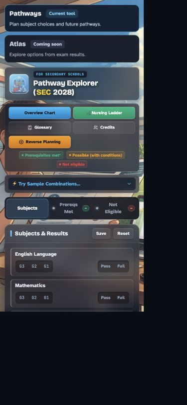

# Pathways Test and Evidence Matrix

## Current PR checks

Baseline: `c9eb764`. Current PR changes only availability markup/styles plus planning
artifacts. Admissions logic and Atlas remain unchanged. Record actual execution here;
a planned scenario is not an automated test or a passing result.

| Check | Requirement | Status |
| --- | --- | --- |
| Availability reflow at 320, 375 and 1440 CSS pixels | FR-001, FR-006, SC-001 | Passed local browser check, 2026-10-28 |
| Atlas has no link/button/tab stop; words communicate status | FR-001 | Passed local browser check, 2026-10-28 |
| Existing subject preset and reverse entry still respond | FR-003, FR-007 regression smoke | Passed local browser check, 2026-10-28 |
| Inline scripts and Atlas source unchanged from baseline | FR-011 boundary | Passed: byte-for-byte inline-script comparison and unchanged Atlas diff |
| Spec Kit prerequisite, task format and document-link checks | Planning consistency | Passed: prerequisites, JSON, links, ordered tasks and requirement coverage |

The widths above are effective `window.innerWidth` CSS values, not just outer-window
sizes. At 320/375 the entries stack and document width equals viewport width; at 1440
they share a row within the viewport. DOM inspection found no focusable controls in
the availability section. The 6-G3 combined-science preset, mobile result view and
reverse-planning entry responded, and no console errors were captured. This is a
regression smoke check, not an admissions-accuracy or complete mobile usability result.

Document review mapped 11 functional requirements and 5 success criteria to 20 ordered
tasks; 5 setup/placeholder tasks are complete and 15 implementation/release tasks remain.
Review caught and corrected profile-version identity, runtime-row/file normalisation,
and existing browser Save/restore/error coverage before the final consistency check.

## Future journey and rule checks

| ID | Scenario and expected result | Requirement | Layer / task |
| --- | --- | --- | --- |
| R01 | All/partially unset: identify missing inputs, never assume pass/fail | FR-003 | Reviewed fixture + browser; T005, T009 |
| R02 | Reviewed mixed G1/G2/G3 combination: expected prerequisite explanation | FR-003, FR-004, FR-011 | Independent official-source fixture; T005–T006 |
| R03 | G3 fail-grade and threshold boundary: distinguish level conversion and missing subject | FR-003, FR-011 | Independent fixture; T005–T006 |
| R04 | Duplicate/science-limit/profile choice: explain school-specific scope | FR-005 | Fixture + browser; T005, T009–T011 |
| J01 | Complete/edit combination; see limits, years and source without lost state | FR-004, FR-006 | Browser; T009–T011 |
| J02 | Reverse search has no matches: explain and clear/change search | FR-007 | Browser; T012–T013 |
| J03 | Compare two options on phone; labels/actions remain attached to each | FR-006, FR-007 | Browser; T012–T013 |
| J04 | Apply suggestion, cancel/undo, return to original work | FR-007 | Browser; T012–T013 |
| F01 | Partial and complete summary: readable pages, sources/version and uncertainty | FR-008 | Browser + rendered PDF inspection; T015, T017 |
| F02 | Export/import in fresh context: canonical effective inputs and comparisons restored; implicit taken/None/stale failure fields normalised | FR-009 | Round-trip + browser; T014–T016 |
| F03 | Oversize/invalid/unknown schema, profile, subject or level: no overwrite | FR-009 | File/profile-version/adapter fixtures; T014, T016 |
| F04 | Older rules file: explicit mismatch/recalculate choice; no stale outcome | FR-009 | File + browser; T014–T016 |
| F05 | Existing Save/reload/reset, corrupt/blocked storage and cancelled import/print: truthful feedback, work retained and export usable | FR-003, FR-008, FR-009, FR-010 | Browser; T009, T011, T015–T017 |
| A01 | No login; keyboard/screen-reader labels, focus restoration and readable status | FR-002, FR-006 | Browser + assistive-tech check; T018 |
| A02 | 320/360/375/390/430/768/1440 widths; landscape, 200% text, open keyboard, Back | FR-006 | Browser + physical iOS/Android; T018 |
| P01 | Core entry/edit/import/export sends no student data over network | FR-010 | Synthetic payload inspection; T018 |
| U01 | Four of five proposed pilot users complete planning/summary and understand limits | SC-005 | Recorded pilot; T019 |

For R02/R03, do not fill expected answers from either prototype. A case needs official
reference, checked date, independently calculated outcome and named reviewer before it
is a release oracle. The current PR neither runs nor claims Atlas engine/matcher/parity
results. Existing Atlas tests are retained for later shared-rule changes.

## Later hosted measurement slice

Propose fixed events for journey start, result explanation, comparison, export success
and official-source click. Export success means the app generated a file, not proof
that the user saved/read it. Exclude subjects, grades, school, file contents, free text
and private URLs. Verify safe metadata and Enhanced Measurement settings, production
hostname gating, single events, payloads and GA Realtime/DebugView receipt. No analytics
or database is installed or activated by this PR.
